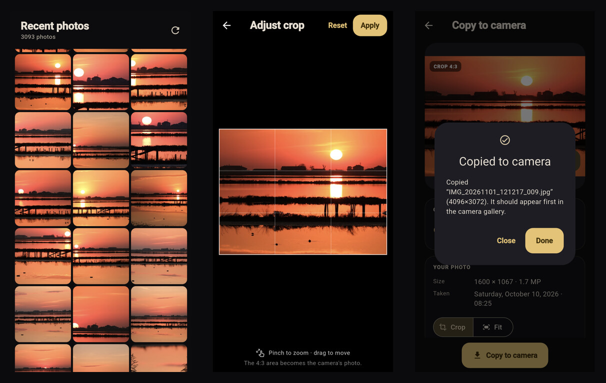

# Insta360 Print Anything — mobile


Browse the photos on your phone, pick one, and copy it onto a USB-connected
Insta360 camera so the camera lists it like one of its own shots. Mobile port of
[insta360-print-anything](https://github.com/kkazakov/insta360-print-anything).

Android today; **iOS can be implemented on demand.**

[Download the APK](https://github.com/kkazakov/insta360-print-anything-mobile/releases/latest) ·
[Changelog](CHANGELOG.md) · [Release process](AGENTS.md#release-process)

## Download

Grab `insta360-print-1.1.0.apk` from the
[latest release](https://github.com/kkazakov/insta360-print-anything-mobile/releases/latest).
The APK is signed for direct installation; the app is not on Google Play.

- Android 9 (API 28) or newer, with USB-C host/OTG support.
- Connect the GO Ultra with a data cable and set it to **USB storage / file
  transfer** mode.
- If a debug build is installed, uninstall it first — the release is signed with
  a different key and Android will reject the update otherwise.
- Grant photo access on first launch. On the review screen, grant the camera
  drive once (named **disk** on the tested GO Ultra); the grant is remembered per
  camera.
- `insta360-print-1.1.0.aab` is attached for Google Play/internal distribution.

## Screenshots

[](docs/screenshots/overview.jpg)

Recent photos, the 4:3 crop editor and the copy confirmation. More:
[camera picker](docs/screenshots/02-camera-picker.png) ·
[review with the default crop](docs/screenshots/03-review-crop.png) ·
[crop editor](docs/screenshots/04-crop-editor.png) ·
[panning the crop](docs/screenshots/05-crop-editor-panned.png) ·
[adjusted review](docs/screenshots/06-review-adjusted.png) ·
[copy success](docs/screenshots/07-copy-success.png).

Screenshots use a curated sunset-only photo set.

## Requirements

- Flutter 3.47 / Dart 3.13
- Android SDK 36, a phone with USB-C host support (`android.hardware.usb.host`)
- **minSdk 28** (the native image pipeline uses `ImageDecoder`), `largeHeap` on
- **Java 21 for Gradle.** This machine's default JDK is 27, which Gradle 9.3.1
  rejects (`Unsupported class file major version 71`). Build with:

  ```bash
  JAVA_HOME=/usr/lib/jvm/java-21-openjdk flutter run
  ```

- **Release signing.** Create `android/key.properties` (gitignored) with
  `storePassword`, `keyPassword`, `keyAlias` and `storeFile` (absolute path to
  the keystore). Without it, the Gradle release build falls back to the debug
  key — fine for local testing, not for distribution. The production key is not
  in this repository.

## Commands

```bash
flutter pub get
flutter analyze
flutter test                                   # 135 Dart unit + widget tests
flutter build apk --debug                      # JAVA_HOME=… as above
flutter build apk --release                    # signed with android/key.properties
flutter build appbundle --release              # Play AAB
flutter run                                    # install on the connected phone

# verify a signed release (build-tools 37.0.0):
apksigner verify --print-certs build/app/outputs/flutter-apk/app-release.apk

# native encoder unit tests (JVM, no device):
cd android && JAVA_HOME=/usr/lib/jvm/java-21-openjdk \
  ./gradlew :app:testDebugUnitTest --tests 'com.wasp.insta360_print_anything_mobile.camera.*'

# on-device native pipeline test (needs photo access; writes to the app cache):
JAVA_HOME=/usr/lib/jvm/java-21-openjdk \
  flutter test integration_test/native_pipeline_test.dart -d 192.168.88.10:44045

# wireless device (paired on this machine):
adb devices
adb -s 192.168.88.10:44045 install -r build/app/outputs/flutter-apk/app-debug.apk
```

## How it behaves

1. **On open** the app asks for photo access (`PhotoManager.requestPermissionExtend`,
   images only). The first page (80 newest photos) is loaded immediately.
2. **If access is not granted** the gallery is replaced by a prompt with
   *Allow access* — which re-runs the system prompt — and *Open settings*. A
   restricted state only offers Settings. On resume the permission is re-read,
   so returning from Settings updates the grid without a restart.
3. **A limited grant** (Android 14 "Select photos") shows the grid plus an AppBar
   banner with *Manage*, which re-opens the system picker.
4. **Tapping a photo** opens a bottom sheet that lists attached USB cameras.
   Tapping one asks Android for USB access to that device.
5. **Choosing a camera** opens the review screen. If this camera has no stored
   folder grant yet, the *Camera storage* card asks for the camera drive once
   (`ACTION_OPEN_DOCUMENT_TREE`); the grant is persisted per camera model.
   *Crop* / *Fit* chooses how the photo is mapped onto the camera frame. With
   *Crop*, tap **Adjust** on the preview (or *Adjust crop* below the toggle) to
   open the 4:3 editor: pinch to zoom, drag to move, then *Apply*. The crop is
   sent to the native decoder, so the file the camera gets is exactly what the
   4:3 frame showed.
6. **Copy to camera** rebuilds the photo and writes it to the camera, with a
   progress line for reading, encoding, writing, indexing and verification.

## Android configuration

`AndroidManifest.xml` declares:

| Permission / feature | Why |
|---|---|
| `READ_MEDIA_IMAGES` | Android 13+ gallery |
| `READ_MEDIA_VISUAL_USER_SELECTED` | Android 14+ partial (selected photos) access |
| `READ_EXTERNAL_STORAGE` (`maxSdkVersion=32`) | older Android gallery |
| `uses-feature android.hardware.usb.host` (`required=false`) | discover the camera |
| `android:largeHeap="true"` | 37–50 MP encodes on low-heap devices |

Three Kotlin channels:

| Channel | Purpose |
|---|---|
| `insta360_print_anything_mobile/usb_cameras` | enumerate USB devices, request per-device access |
| `insta360_print_anything_mobile/camera_storage` | SAF tree grant + list/read/write/delete inside it |
| `insta360_print_anything_mobile/camera_images` | decode/fit/encode the three JPEGs + NV21 natively |

The Insta360 GO Ultra appears as **USB mass storage**, but Android also
auto-mounts its exFAT volume. File access therefore goes through **SAF** (one
persisted tree grant for the drive root), not through a raw SCSI/exFAT driver.
The USB host channel is only used to find the camera and show its identity.

## Verified on the real setup

Tested on 2026-11-01 with a vivo V2515 (Android 16, wireless adb) and an
Insta360 GO Ultra plugged into its USB-C port:

| Fact | Value |
|---|---|
| USB identity | `0x2E1A:0x1006`, manufacturer `Arashi Vision`, product `Insta360 GO Ultra` |
| Interface | one mass-storage interface: class 8 / subclass 6 / protocol 80 |
| Bulk endpoints | OUT `0x01`, IN `0x82`, 512-byte packets |
| Mount | public volume `8,81` → `/storage/4A21-0000`, **exFAT** |
| SAF | the system folder picker lists the drive as **disk** and its root is selectable |
| Contents | `DCIM/fileinfo_list.list` (6,101 B), `DCIM/.editinfo_list.list` (246 B), `DCIM/Camera01/` with three untouched JPEGs, DNGs and an MP4 |

Real sample values used by the tests and cross-checked against the Python tool:

- 4096×3072 original: APP1(11428) APP2×3 DQT(130) SOF0(15) DHT(416); preview
  704×544, EXIF thumb 160×120; trailer 576,170 B; serial `IBEEA26045GQ9B`; UID
  `8db42d694ccc418790edff439fe026bf`; field 9 = 3,322,996; blob 431/1151.
- 8192×4608 original: preview 704×416, thumb 160×96, DRI present.
- `fileinfo_list.list`: 5 records, 1,201/1,297/1,201/1,201/1,201 bytes.
- `.editinfo_list.list`: 5 records, 48/48/50/50/50 bytes.

## Architecture

Layered as UI → ViewModel → Repository → Service; domain models are plain Dart
and layer boundaries are interfaces, so widget and engine tests need no plugins
(the photo copy engine test runs on real sample bytes with a fake native
pipeline).

```
lib/
├── main.dart                     wiring (repositories + real copy engine)
├── app.dart                      MaterialApp + theme
├── core/{theme,ui}
└── features/
    ├── gallery/
    │   ├── domain/               PhotoAsset, PhotoPage, GalleryAccess,
    │   │                         GalleryRepository
    │   ├── data/                 DeviceMediaService, PhotoManagerGalleryRepository
    │   └── presentation/         GalleryViewModel, GalleryPage, PhotoGrid,
    │                             PhotoTile, PermissionPrompt, LimitedAccessBanner
    ├── cameras/
    │   ├── domain/               UsbCamera, CameraRepository,
    │   │                         CameraStorage + CameraStorageRepository
    │   ├── data/                 USB + SAF channel clients and repositories
    │   └── presentation/         CameraPickerViewModel, CameraPickerSheet, CameraCard
    └── copy/
        ├── domain/               CopyRequest/CopyResult/CopyEngine/CopyProgress,
        │                         CameraImagePipeline (+CopyFit)
        ├── data/                 CameraCopyEngine, CameraImageService
        ├── format/               jpeg.dart, exif.dart, meta.dart, template.dart
        └── presentation/         CopyReviewPage
android/.../com/wasp/insta360_print_anything_mobile/
├── MainActivity.kt               registers all channels + folder-picker result
├── UsbCameraChannel.kt           USB host enumeration + permission
├── CameraStorageChannel.kt       SAF tree grant and document I/O
├── CameraImageChannel.kt         pixel pipeline channel
└── camera/
    ├── CameraJpegEncoder.kt      baseline 4:2:0 encoder with custom DQT
    ├── CameraNv21.kt             raw gallery buffer conversion
    └── CameraImagePipeline.kt    ImageDecoder + fit + three encodes + NV21
```

Grid sizing is one `SliverGridDelegateWithMaxCrossAxisExtent` (max 128 dp,
4 dp gutters): 3 columns on a phone portrait, 6–7 in phone landscape, 8+ on a
tablet, with 24 dp page padding from 720 dp width up.

## The copy pipeline

`CameraCopyEngine`:

1. Lists `DCIM/Camera01` through the SAF grant and picks a template: the newest
   camera JPEGs are read (up to 6), filtered to files that carry the camera
   trailer, and the **smallest mode** is preferred (12.6 MP on this camera) for
   speed and memory. The template supplies EXIF, DQT, preview/thumbnail sizes,
   model, serial, UID and trailer.
2. Dates the copy as `max(now, newest camera photo + 1 min)` and picks the next
   `IMG_YYYYMMDD_HHMMSS_NNN.jpg` number.
3. Calls the native pipeline: decode the selected photo with `ImageDecoder`,
   fit/crop to the template's frame, encode three baseline JPEGs (main, 704-px
   preview, 160-px thumbnail) with the camera's DQT, and build the raw NV21
   gallery buffer.
4. Patches the template EXIF (name, three dates, pixel dimensions, thumbnail),
   wraps it as APP1 before the DQT/SOF0/DHT/SOS, and chunks the preview into
   APP2.
5. Patches the trailer: 27-char path, NV21 buffer, field 7 (time) and field 9
   (`body.length + 431`).
6. Verifies its own output (APP1 first, EXIF make/model/name, DQT match, preview,
   field 7/9, serial/UID, native decode), writes the file, prepends the record
   to `DCIM/fileinfo_list.list` and `.editinfo_list.list`, reads both back and
   rolls everything back if the index does not stick.

The chroma order in the raw buffer is **Y + interleaved U,V**, despite the
reference tool's `nv21_from_image` name and README saying NV21. This was
measured against two real camera originals: U-first matches the embedded APP2
preview far better than V-first, and getting it backwards turns faces blue
because the camera draws this buffer in its gallery.

## Transport note

The camera volume is mounted by Android, so no raw USB mass-storage driver is
needed. SAF gives one persisted grant for the drive root; the app stores it per
camera (VID:PID) and validates that the chosen folder contains
`DCIM/fileinfo_list.list` before accepting it. If a future body is not mounted by
Android, the fallback would be USB MSC (SCSI over `bulkTransfer`) plus an exFAT
driver — deliberately not implemented.

## On-device verification

### Real GO Ultra (2026-11-01, 11:19)

With the camera mounted and the drive granted once as **disk**, copying a
4080×3072 phone photo produced `DCIM/Camera01/IMG_20261101_111907_005.jpg`
(3,066,334 B, 4096×3072) directly on the camera:

- Python reference `analyze`: **8/8 camera fingerprints**; APP1(13827), APP2×3,
  DQT(130), SOF0(15), DHT(416), no DRI;
- field 9 = 2,490,595 (= body end + 431), field 7 = 20261101111907;
- `DCIM/fileinfo_list.list` 6,101 → 7,302 B, 6 records, new one **first**,
  its 1,151-byte blob byte-identical to the trailer blob;
- `.editinfo_list.list` 246 → 294 B, new 48-byte record first;
- NV21 vs embedded preview: mean RGB difference 1.9–2.1 (max 17);
- `djpeg` decodes without warnings; the decoded picture is the selected photo;
- the author confirmed the camera lists the copied photo first and displays the
  right picture.

The pre-write indexes are backed up in `/tmp/camera-backup/` and
`.dev-samples/camera-backup-*.list` (gitignored).

### Simulated camera folder (2026-11-01, earlier)

When no camera is attached, the app can be built with a compile-time demo entry:

```bash
flutter build apk --debug --dart-define=INSTA360_DEMO_CAMERA=true
```

The empty camera sheet then shows *Use demo camera folder*. Put any folder that
contains `DCIM/fileinfo_list.list` + `DCIM/Camera01/*.jpg` on the phone (e.g.
`Download/insta360-sim`) and grant it. Normal builds default to false and
tree-shake the entry out.

Run of 2026-11-01 on the vivo V2515, copying a 4080×3072 phone photo:

- output `IMG_20261101_111035_005.jpg`, 3,066,334 B, 4096×3072;
- marker layout APP1(13827) APP2×3 DQT(130) SOF0(15) DHT(416), no DRI;
- field 9 = 2,490,595 (= body end + 431), field 7 = 20261101111035;
- `DCIM/fileinfo_list.list` 6,101 → 7,302 B with the new record first;
  its 1,151-byte blob is byte-identical to the trailer blob;
- `.editinfo_list.list` 246 → 294 B, new 48-byte record first;
- NV21 vs the embedded APP2 preview: mean RGB difference 1.9–2.1 (max 17);
- the decoded main image is the selected phone photo, not the template.

The verified copy is kept locally at `.dev-samples/mobile-copy-verified.jpg`
(gitignored).

## App icon

The launcher icon is the dark camera + photo-card mark on an Insta360-yellow
gradient, generated from a single SVG. Sources and the generator live in
`tool/icon/`:

```bash
python3 tool/icon/generate_icons.py   # needs pillow + cairosvg
```

It writes the legacy + round mipmaps, the adaptive foreground layers for all
densities, the adaptive XML and the background gradient. `tool/icon/app_icon-512.png`
is the store/readme preview.

## Testing

```bash
flutter test
cd android && JAVA_HOME=/usr/lib/jvm/java-21-openjdk \
  ./gradlew :app:testDebugUnitTest --tests 'com.wasp.insta360_print_anything_mobile.camera.*'
```

- **135 Dart tests** in a full development checkout (26 of the sample-backed
  tests skip cleanly when `.dev-samples/` is absent): gallery state machine, USB
  payload/classification, camera picker, SAF repository rules, permission and
  review widgets, layout reflow, crop-window geometry, the crop editor's
  pan → copy wiring, the whole copy format core (69 tests, with byte-identical
  cross-checks against the Python tool), and the copy engine end-to-end on real
  sample bytes (build, verify, index prepend, rollback).
- **10 Kotlin JVM tests**: encoder marker/DQT/DHT layout, ImageIO round-trips at
  odd sizes, determinism, NV21 video-range values and U/V order.
- **3 on-device integration tests** (`integration_test/`): decode the newest
  real gallery photo (37.7 MP), encode 4096×3072 + 704×544 preview + 160×120
  thumbnail with the camera DQT, and build the 574,464-byte NV21 buffer; a
  pad-fit encode at 1024×768; and a custom crop window through the native
  decoder. Ran green on the vivo V2515; the app's `run-as` is broken on that
  ROM, so the outputs were not pulled, but the marker/DQT/size assertions ran on
  the device.

## Future work

- Portrait/16:9 sources currently use the camera's smallest 4:3 mode. The crop
  editor makes the kept window explicit, but matching the source aspect to a
  37 MP 16:9 camera mode is still future work; available modes differ by body.
- Open the folder picker directly at the USB drive (`EXTRA_INITIAL_URI` is
  ignored by this device's DocumentsUI).
- Remember the SAF grant per physical body rather than per VID:PID.

The reference material lives on the camera: three untouched GO Ultra JPEGs, the
index files and the hidden metadata (copied locally to `.dev-samples/`, which is
gitignored).
